# data

## 2.1 types of data

### 2.1.1 *attributes and object*

é uma coleção de objetos de dados e seus atributos. um **atributo** é a propriedade ou características de um objeto. uma coleção de atributos descreve um **objeto**.

**valores dos atributos** podem ser números ou símbolos. distinção entre atributos e valores dos atributos:

- o mesmo atributo pode ser mapeado para diferentes valores de atributos
- diferentes atributo podem ser mapeados para o mesmo conjunto de valores

**medida de comprimento:** a forma que se mede um atributo talvez não seja a correta para as propriedades do atributo. um atributo pode ser medido de uma maneira em que não capture todas as propriedades do atributo.

**tipos de atributos**

- nominais (ex.: ID, cor do olho...)
- ordinais (ex.: altura, notas, ranking...)
- intervalares (não representa a ausência de valor -> ex.: datas de calendário, temperatura em C° ou F°...)
- escalares (representa a ausência de valor -> ex.: temperatura em Kelvin, peso, medição de tempo)

**operações em atributos**
o tipo de operação permitida é baseado no tipo de atributo.

- diferenciadores (= e !=)
- ordem (< > <= >=)
- adição (+ e -)
- multiplicação (* e /)

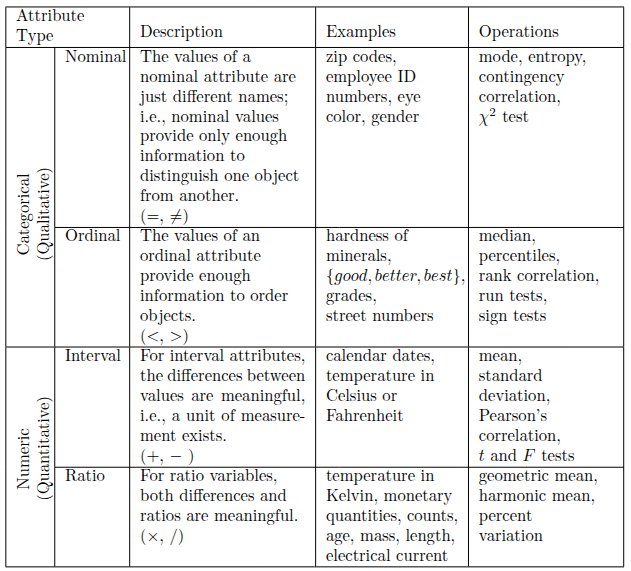

**atributos binários**
é um *subset* dos nominais, apresentando dois valores (yes/no, true/false).

- simétrico: ambos os valores importam (ex.: gênero)
- assimétrico: os valores não são igualmente importantes (ex.: um booleano que define se um estudante fez ou não uma materia na faculdade, a maioria é 0, o que mais importa é as que ele fez e tem 1)

### 2.1.2 *types of data sets*

**características chaves**

- dimensionalidade: nuimero de atributos do objeto
- distribuição: frequência da ocorrência de vários valores, ou conjunto de valores, para os atributos dos objetos de dados.
- resolução: os padrões dos dados dependem do nível de resolução, se a resolução é muito alta, um padrão pode não ser visível ou borrado por *noise*.

***record data***

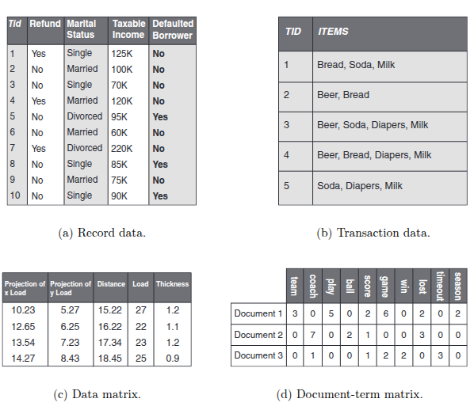

- *record data*: forma básica, onde não há relacionamento entre os registros/atributos.

- *transaction or market basket data*: cada registro envolve uma coleção de items, muito associado a "dados de uma cesta de mercado"

- *data matrix*: todos objetos tem a mesma quantidade de atributos numéricos, e podem ser interpretados como vetores, que unidos formam uma matriz.

- *sparse data matrix*: os atributos são de mesmo tipo e são assimétricos (apenas valores não nulo importam)

***graph-based data***

tem duas vertentes: (i) o grafo captura a relação entre os objetos; (ii) os objetos de dados representam eles mesmos como grafos.

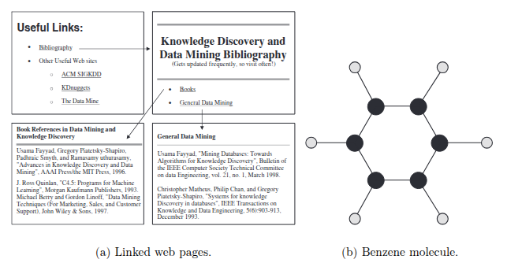

***ordered data***

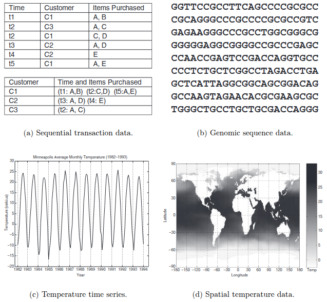

- *sequential transaction data*: é uma extensão de transaction data, onde cada transação tem um tempo associado a ela.

- *time series data*: cada registro é uma série temporal.

- *sequence data*: é uma sequência de entidades individuais, como uma sequência de palavras ou letras.

- *spatial and spatio-temporal data*: objetos que tenham atributos espaciais (posição, área...).

---

## 2.2 data quality

### 2.2.1 *measurement and data collection issues*

#### *measurement and data collection errors*

*measurement error* é o erro de medida, onde o valor registrado difere do valor real.

já o *data collection error* se refere ao erro de campos vazios ou inclusao de objetos que não pertencem ao domínio estudado.

#### *noise and artifacts*

*noise* é um erro de medida aleatório. causa a perda do formato de dados espaciais/temporais, e em domínios mais comuns (imagens e sinais) existem formas de remover esses ruídos. porém, na maioria dos casos foca-se em criar algoritmos robustos que produzam resultados aceitáveis mesmo com *noise*.

*artifacts* é um erro causado por um fenômeno determinístico, onde consegue-se encontrar o motivador daquele "ruído", que então é chamado de artefato.

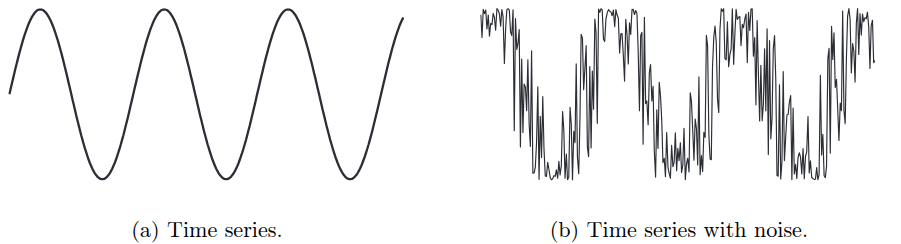

#### *precision, bias and accuracy*

>*precision:* proximidade entre medidas repetidas de mesma grandeza
>*bias:* variação sistemática das medições em relação à grandeza que está sendo medida

a precisão geralmente é medida pelo desvio padrão, já o bias pela diferença entre a média do conjunto e o valor conhecido da grandeza sendo medida (ex.: lab padrao mediu que a massa é 1g, porem a media das minhas medicoes é 1.001g, então o bias é de 0.001).

>*accuracy:* proximidade das medidas ao valor verdadeiro da grandeza sendo medida.

os digítos significantes são importantes, onde a quantidade de dígitos deve seguir o limite dos instrumentos de medida utilizados, sem aumentar a precisão sem ter certeza do valor que se está assumindo.

#### *outliers*

são (i) instancias que tem características diferentes do restantes do conjunto ou (ii) valores de atributos que são incomuns de acordo com valores típicos do atributo.

são referidos também como anomalias, porém não podem ser confundidos com ruído, onde pode ser dados legitimos que são interessantes em detectar.

#### *missing values*

a informação pode não ter sido coletada (ex.: alguem negou forneceu sua idade e peso), pode não ser aplicável para todos os objetos e vários outros motivos podem causar a falta de valores. há diversas maneiras para lidar com isso, como por exemplo:

- eliminar instâncias/atributo vazio
- estimando valores (interpolação)
- igmorar valores vazios (ex.: ao calcular a proximidade, não utilziar os campos vazios)

#### *inconsistent values*

ex.: CEP que não corresponde a cidade atribuída ao objeto. 

existem casos fáceis (altura e peso negativos), porém outros precisam ser consultados em fontes externas.

#### *duplicate data*

pode ser duplicatas identicas ou quase identicas. os mesmos dados podem aparecer diversas vezes porem com nomes diferentes. os processos que resolvem isso são chamados de *deduplication*.

### 2.2.2 *issues related to applications*

>"os dados são de alta qualidade se forem utilizados no contexto correto"

#### *timeliness*

dados que representam valores de determinado período de tempo podem não ter mais qualidade após o período ter passado.  

#### *relevance*

os dados precisam ter as informações necessárias para a aplicação, com um problema comum sendo o *sampling bias*, em que o recorte escolhido não representa o conjunto todo (perde-se proporções).

#### *knowledge about the data*

idealmente os conjuntos de dados tem sua documentação, assim possibilitando uma compreensão correta de seus atributos.

---

## 2.3 data preprocessing

aggregation, sampling, feature subset selection, dimensionality reduction, feature creation, discretization and binarization, attribute transformation.

### 2.3.1 *aggregation*

- combina dois ou mais objetos em um único (perde-se os detalhes)
- atributos quantitativos são somados ou calculado a média (ex.: preço de vendas)
- atributos categóricos são associadas a uma categoria mais macro (ex.: tv -> eletronicos)
- ex.: agrupar as transacoes de vendas por loja, por data...
- motivações: redução de dados, mudança de escala, mais "estabilidade" nos dados

### 2.3.2 *sampling*

- técnica de redução de dados, escolhe-se um subset dos objetos
- usada para investigação preliminar dos dados, evitando altos custos de processamento do conjunto inteiro
- usar uma amostra representativa funciona da mesma maneira que usar o dataset completo
- existem varios tipos de amostragem, dividas em dois "grupões" (i) probabilisticas e (ii) não-probabilisticas. dentro de ML os tipos mais comuns são:

#### *simple random sampling*

todas instancias tem a mesma prob de serem selecionado, pode ser com/sem substituição (sem: uma vez selecionado aquele item, ele nao pode ser selecionado novamente | com: apos selecionar, nao remove-se a amostra do dataset, entao pode repetir)

a amostragem com substituição (mantendo no dataset) é mais simples de se analizar por conta da probabilidade dos objetos serem escolhidos se manter constante

#### *statified sampling*

quando-se tem diferentes tipos de objetos, com diferentes quantidades para cada tipo, a amostragem randômica não fica representativa (em sua maioria das vezes). nesses casos, usa-se a representação estratificada, a qual tenta manter todas as classes existentes de duas formas: (i) pega a mesma quantidade de todas as classses; (ii) mantem a proporção das classes, cada um com uma quantidade proporcional a divisão original

#### *progressive sampling*

definir o tamanho da amostra pode ser difícil, então uma amostragem adaptativa ou progressiva é utilizada. define-se uma métrica de qualidade do sampling, por exemplo a acc de um modelo para cada amostra.

### 2.3.3 *dimensionality reduction*

data sets com grandes quantidades de features (ex.: conjunto de documentos onde cada documento é representado por um vetor que tem as frequências de cada palavra utilizada no doc). reduzir a dimensionalidade elimina features irrelevantes e reduz ruído.

#### *the curse od dimensionality*

quanto mais dimensões os dados tem, se torna mais difícil de analisa-los. os dados ficam esparsos no espaço, perdendo representatividade, dificultando para modelos classificatórios e de clustering.

#### *linear algebra techniques for dimensionality reduction*

**Principal Componentes Analysis (PCA)** é uma técnica para atributos contínuos que encontram novos atributos que: (i) são combinação linear de atributos originais; (ii) são ortogonais (perpendiculares) um ao outro; (iii) caputram a quantidade máxima de variação nos dados. 

**Singular Value Decomposition (SVD)** é uma técnica de algebra linear que está relacionado ao PCA e também é utilizado para reduzir dimensionalidade.

### 2.3.4 *feature subset selecion*

- reduz a dimensionaliadde dos dados
- features redundantes e/ou irrelevantes são removidas 
- a seleção de features tem como benefícios: reduzir tempo de treinamento; aumentar generalização -> reduzindo overfitting;
- atributos irrelevantes e redundantes são fáceis de remover, porém escolher o melhor sub-conjunto de atributos requer abordagens sistemáticas. o ideal seria testar todas as possibildiades, porém tem um custo de com $n$ atributos levar $2^n$ testes.
- por conta disso, existem tres abordagens padrão:
  - *filter*: filtram antes do algoritmo de data mining ser executado. existem vários tipos de filtros, por exemplo, pode-se selecionar os atributos os quais tem a menor correlação entre eles (afasta-se da redundância)
  - *wrapper*: usa o algoritmo de data mining alvo como uma *black box* para encontrar o melhor subset de atributos, similar a testar todos, porem sem de fato testar todos
  - *embedded*: durante a operação do algoritmo de data mining, o algoritmo do data mining decide quais atributos usar e quais ignorar

#### *an architecture for feature subset selection*

é possível incorporar a abordagem por filtro e por wrapper dentro da mesma arquitetura.

o processo de seleção de features tem quatro partes: (i) medida de avaliação de um subset; (ii) estratégia de busca que controla a geração de novos subsets de features; (iii) critério de parada; e (iv) procedimento de validação;

filter e wrapper se diferem apenas na avaliação dos subsets, onde o wrapper avalia como algoritmo de data mining, já o filtro é distinto do algoritmo de data mining.

as *search strategies* são diversas, idealmente deveriam ser leves computacionalmente e encontrar o conjunto ótimo (ou próximo de) de features.

a avaliação precisa de uma métrica que determine a qualidade do subset dado a tarefa de data mining em uso. para filtros, a avaliação tenta prever quão bem se sairá o conjunto, já para o wrapper roda-se o algoritmo e usa-se sua medida avaliativa.

critério de parada são baseadas em uma ou mais das seguintes condições: (i) n° de iterações; (ii) quando a métrica é ótima ou excede o threshold; (iii) quando um subset de determinado tamanho tenha sido obtido; e (iv) quando qualquer melhora pode ser atingida pelas opções de avaliação da *search strategy*.

após selecionar o subset, a validação final compara o algoritmo de data mining com o conjunto completo com o subset encontrado.

#### *feature weighting*

quão mais importante a feature, maior seu peso. pesos são dados baseado no conhecimento das features, ou podem ser atribuidos automaticamente.

### 2.3.5 *feature creation*

pode-se criar atributos para reduzir o total de atributos de um conjunto, visando manter os dados mais importantes. esse processo é específico por domínio, sendo raro a utilização de uma técnica em mais de um domínio. existem duas metodologias gerais:

- *feature extraction*: é a criação de novas features a partir do conjunto cru. ex.: artefatos históricos que originalmente tinha volume e massa para cada material que é constituido, então combina-se eles e cria-se a densidade pra cada material, assim reduzindo de 2 para 1 atributo.

- *mapping the data to a new space*: é a mudança dos dados, criando novas visões sobre o conjunto. ex.: utilização de transformada de fourier para entender o padrões complexos.

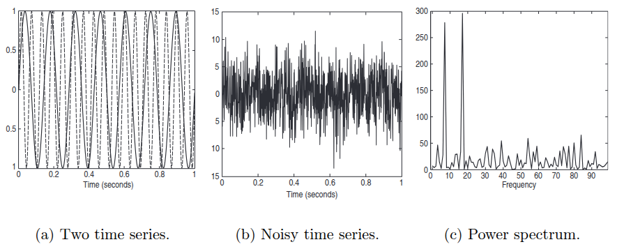

### 2.3.6 *discretization and binarization*

alguns algoritmos de data mining precisam dos dados em formatos categóricos. algoritmos que  encontrão padrões precisam de dados binzarizados.

>*discretization*: transformar um atributo contínuo em categórico.
>*binarization*: transformer atributos contínuos/discretos em um, ou mais, atributo(s) binário(s).

a melhor abordagem é aquele que produz o melhor resultado para o determinado contexto de algoritmo que se está trabalhando.

#### *binarization*

a mais simples é atribuir um inteiro a cada atributo categórico (ex.: temos $m$ valores categóricos, então associamos unicamente cada categoria a um inteiro dentro de $[0, m-1]$). se as categorias forem ordinais, precisa-se manter a ordem. após isso, converte cada um dos $m$ inteiros em binários, então $n$ digitos binários serão utilizados, sendo $n = \lceil \log_2(m) \rceil$.

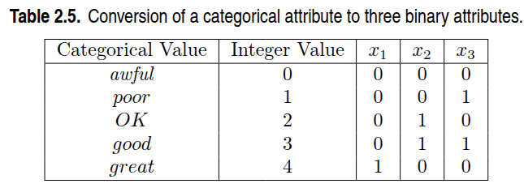

esse exemplo mostra que pode-se criar relações inexistentes entre os atributos, como em *good* onde $x_2$ e $x_3$ são correlacionados porque ambos fazendo o encoded de *good*. além disso, a análise de aassociação requer atributos binários assimétricos, onde apenas a presença/ausência do atributo importa, como é visto na tabela abaixo:

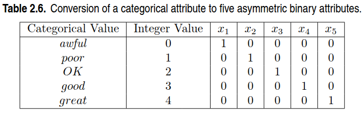

se a quantidade de atributos for muito larga, então deve-se reduzir o n° de categorias antes da binarização. então, a associação assimétrica pode precisar que troque um único atributo binário por dois assimétricos binários (ex.: genero que era 0 homem e 1 mulher, precisa então criar dois atributos, um para homem e outro para mulher).

#### *discretizatrion of continuoes attributes*

a trnasformação de contínuo em categórico involve duas partes: (i) decidir quantas $n$ categorias terá; e (ii) determinar como mapear os valores para esses categorias.

(i) ordena-se os valores, então divide eles em $n$ intervalos, especificando $n - 1$ pontos de divisão. (ii) todos valores dentro de cada intervalo são mapeados para a mesma categoria.

***unsupervised discretization*** é a discretização que não usa informações de classes, a qual tem abordagens mais simples. a abordagem por **largura igual** divide o conjunto em um número de intervalos definido pelo usuário, em que cada intervalo tem o mesmo tamanho (sofre com outliers). evitando o problema com outliers, tem-se a discretização por **frequência igual**, em que coloca-se a mesma quantidade de objetos em cada intervalo. pode-se utilziar métodos de clusterização, como o K-means

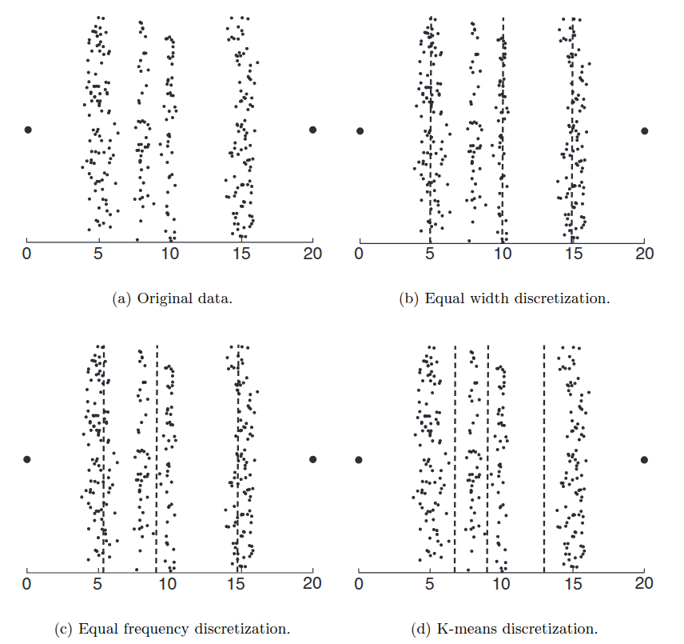

***supervised discretization*** é utilizada em  problemas de classificação, com classes conhecidas. a ideia é dividir o conjunto em splits que sejam puros (sem mix de classes), porém em prática tal ideal requer decisões arbitrárias sobre a purezaa de um intervalo e seu tamanho mínimo. para superar isso, existem abordagens estatísticas que começam com cada valor de atributo sendo um intervalo e vai mergeando intervalos adjacentes estatísticamente similares. outra alternativa é dividir inicial o conjunto em duas partes que tenham a mínima entropia.

>*entropy*: sendo $k$ o n° de classes, $m_i$ a quantidade de valores no $i^{ésimo}$ intervalo de um partição, e $m_{ij}$ o n° de valores da classe $j$ no intervalo $i$. então a entropia $e_i$ do $i^{ésimo}$ intervalo é igual a  $$e_i = - \sum_{j=1}^k p_{ij} log_2 p_{ij}$$ onde $p_{ij} = m_{ij}/m_i$ é a probabilidade da classe $j$ no $i^{ésimo}$ intervalo. então a entropia total $e$ é a média ponderada dos valores de entropia de cada intervalo $$e =  \sum^n_{i=1} w_i e_i$$ onde $m$ é o número de valores, $w_i = m_i/m$ é a fração  de valores no $i^{ésimo}$ intervalo, e $n$ é o n° de intervalos.

#### *atributos categóricos com muitos valores*  

utiliza-se de conhecimento do domínio (ex.: temos um atributo de disciplinas em uma grande universidade, então agrupa-se por cursos, ou ainda mais, por departamentos). caso não seja possível,  ou produza resultados ruins, então usa-se  de  abbordagens empiricas, como  agrupar apenas as classes que ao serem unidas melhoram os resultados do algoritmo.

### 2.3.7 *variable transformation*

transformação aplicada a todos os valores de uma variável (atributo).

***simple functions*** é quando aplica-se uma simples função matemática (ex.: $x$ vira $x^k$, $log x$, $e^x$, $\sqrt{x}$, $\dots$). na estatística utilizam para transformar sem características guassianas, aplicando raiz quadrada, log ou 1/x, para então os dados ficarem em uma distribuição guassiana. é essencial utilizar com cuidado, passando pelas seguintes perguntas antes: o que é desejado com a transformação? a ordem precisa ser mantida? a transformação é aplicável em todos os valores, mesmo 0 e negativos? qual é o efeito em valores entre 0 e 1?

***normalization or standardization*** utilizada para um conjunto de valores ter a mesma propriedade. por exemplo, comparar pessoas por meio de idade e renda, as idades tem um range muito menor que a rendam então precisa-se levar em conta isso. comumente utiliza-se a transformação de $x' = (x - \overline{x})/s_x$, onde $\overline{x}$ é a média do atributo e $s_x$ o desvio padrão. então se normaliza usando mediana e o desvio padrão absoluto (sendo $x$ uma variável, o *absolute standard deviation* é $\sigma_A = \sum_{i=1}^{m} |x_i - \mu|$, onde $x_i$ é o i-ésimo valor da variável, $m$ é o total de objetos, e $\mu$ é a média/mediana).

--

## 2.4 measures of similarity and dissimilarity

são importantes pois são utilizadas em diversas técnicas de mineração, como *clustering*, classificação por vizinhos próximos e detecção de anomalias.

### 2.4.1 *basics*

#### *definitions*

a **similaridade** é a medida numérica do grau em que dois objetos são parecidos. geralmente são valores não negativos, entre 0 e 1 (quanto mais próximo de 1, mais parecidos são os objetos).

a **dissimilaridade** é a medida numérica do grau em que dois objetos são diferentes. frequentemente, o termo distância é dado como sinônimo dessa medida, porém este termo é apenas uma classe de dissimilaridade. algumas vezes estão na mesma escala de [0, 1], porém é comum que está entre 0 e +inf.

#### *transformations*

frequentemente utilizadas para converter similaridade em dissimilaridade, ou vice versa, ou para transformar uma medida para um intervalo específico, ex.: [0, 1].

a transformação linear é a mais comum, e segue a seguinte fórmula $$s' = (s - min_s)/(max_s - min_s)$$. a transformação linear presservar as distâncias relativass entre pontos, ex.: ao transformar um *range* [1, 10] para [0, 1], usamos $s' = (s - 1)/9$, a distância relativa entre dois pontos é mantida, onde se dois pontos $x_1$ e $x_2$ são duas vezes mais distantes que $x_3$ e $x_4$ na escala original, isso é mantido na escala resultante.

para intervalos infinitos, como de [0, +inf], pode-se considerar uma transformação como $$d' = d/(1 + d)$$, em que as dissimilaridades 0, 0,5, 2, 10, 100 e 1000 viram 0, 0,33, 0,67, 0,90, 0,99 e 0,999.

mapear medidas de proximidade para o intervalo [0, 1] pode mudar o significado da medida, podendo, por exemplo, perder informação do sinal ao mapear de [-1, 1] para [0, 1], o que pode ser importante em determinado contexto.

transformar similaridade em dissimilaridade pode ser feito por $d = 1 - s$, e existem várias outras fórmulas, onde o que deve ser mantido é que quanto maior o valor original, menor deve ser o valor resultante.

### 2.4.2 *similarity and dissimilarity between simple attributes*

atributos nominais tem sua similaridade booleana, com 1 sendo *match* e 0 caso contrário, já para a dissimilaridade é o contrário, mas seguem booleanos.

objetos com um único atributo ordinal, a ordem deve ser levada em conta, como classes qualidade de um doce, ex.: {ruim, aceitável, ok, boa, maravilhosa}. então coloca-se inteiros mantendo a ordem de qualidade das classes, de 0 a 4 (por exemplo), e então mede-se a distância entre cada classse e ela sse torna o grau de (des)similaridade.

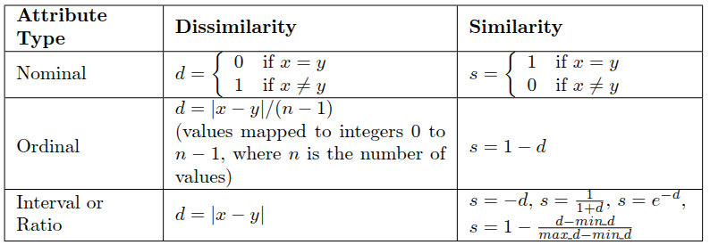

### 2.4.3 *dissimilarities between data objects*

#### *distances*

a distância eucliidiana $d$ entre dois pontos $x$ e $y$ em um espaço n-dimensional, é dado por $$d(x, y) = \sqrt{\sum_{k=1}^n (x_k - y_k)^2}$$. 

outra distância é a de minkowski, definida por $$d(x, y) = (\sum_{k=1}^n |x_k - y_k|^r)^{1/r}$$, onde $r$ é um parâmetro. com $r = 1$ esta distância é utilizada para medir a quantidade de bits diferentess entre dois objetos que só tem atributos binários. com $r = 2$ vira a euclidiana. já com $r = \infty$ é chamado de supremum distance, que é a máxima distância entre quaisquers atributos de objetos. a distância $L_\infty$ é definida por $$d(x, y) = \lim_{r \to \infty} (\sum_{k=1}^n |x_k - y_k|^r)^{1/r}$$.

a distância euclidiana tem as seguintes propriedades:

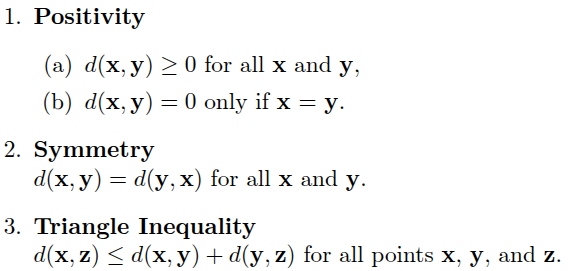

medidas que satisfazam essas propriedades são chamadas de métricas. 

### 2.4.4 *similarities between data objects*

para similaridade a desigualdade triangular não se mantém, tendo continuidade apenas para a propriedade de simetria e de que $s(x, y) = 1$ se, e somente se, $x = y$. uma medida de similaridade dada como exemplo é a a partir da matriz de confusão, em que, a quantidade de falsos positivos (negativo classificado como positivo) indica a similaridade entre os negativos e os positivos, definida por (falsos positivos + falsos negativos) / 2.

### 2.4.5 *examples of proximity measures*

#### *similarity meassures sfor binary data*

medidas entre objetos que contêm apenas atributos binários são chamadas de **coeficientes de similaridade**, e comumente tem valores entre [0, 1] que indicam zero ou total similaridade. a comparação de dois objetos ($x$ e $y$) desta natureza gera quatro quantidades (frequência):

- $f_{00}$ = n° de atributos onde $x$ é 0 e $y$ é 0
- $f_{01}$ = n° de atributos onde $x$ é 0 e $y$ é 1
- $f_{10}$ = n° de atributos onde $x$ é 1 e $y$ é 0
- $f_{11}$ = n° de atributos onde $x$ é 1 e $y$ é 1

***simple matching coefficient (SMC)*** é uma similaridade definida por $$SMC = \frac{f_{11} + f_{00}}{f_{11} + f_{00} + f_{10} + f_{01}}$$ que conta a presença e ausência de igualdade nos valores.

***jaccard coefficient*** é utilizada em matrizes de transação, em contextos onde a quantidade de ocorrências de uma das classes são por natureza assimétricas, como uma matriz com os itens comprados no mercado (teriam muito 0 pois o mercado tem muitos itens). é definido por $$J = \frac{\text{number of matching presences}}{\text{number of attributes not involved in 00 matches}} = \frac{f_{11}}{f_{01} + f_{10} + f_{11}}$$

***cosine similarity*** documentos são representados como vetores, em que cada atributo é frequência de cada palavra no documento. tem poucos *non-zero attributes*, então a similaridade não deve depender da quantidade de 0-0, assim como o jaccard $$\cos(x, y) = \frac{\langle x, y \rangle}{\|x\| \|y\|} = \frac{x'y}{\|x\| \|y\|}$$ o ' indica o vetor/matriz transposta e $\langle x, y \rangle$ indica o produto interno dos dois vetores, $$\langle x, y \rangle = \sum_{k=1}^{n} x_k y_k = x'y$$ e $\|x\|$ é o tamanho do vetor $x$, $\|x\| = \sqrt{\sum_{k=1}^{b} x_k^2} = \sqrt{\langle x, y \rangle} = \sqrt{x'x}$.

***extended jaccard coefficient*** é a versão do jaccard para dados não binários é representado por EJ, que é definido por $$EJ(x, y) = \frac{\langle x, y\rangle}{\Vert{}x\Vert{}^2 + \Vert{}y\Vert{}^2 - \langle x, y\rangle} = \frac{x'y}{\Vert{}x\Vert{}^2 + \Vert{}y\Vert{}^2 - x'y}$$

**correlation** é utilizado para medir a relação linear entre dois conjuntos de valores. então mede a relação entre duas variáveis ou dois objetos. é muito mais utilizada para medir entre atributos, pois os valores em dois objetos podem ter difernetes escalas e tipos. aqui terá o foco em valores numericos.

***Pearson's correlation*** é medida entre dois conjuntos numéricos, dois vetores x e y, e então é definido por $$corr(x, y) = \frac{\text{covariance}(x, y)}{\text{standard\_deviation}(x) \times \text{standard\_deviation}(y)} = \frac{s_{xy}}{s_x s_y}$$ $$\begin{aligned} \bar{x} &= \frac{1}{n} \sum_{k=1}^{n} x_k \text{ is the mean of } x \\ \bar{y} &= \frac{1}{n} \sum_{k=1}^{n} y_k \text{ is the mean of } y \end{aligned}$$

### 2.4.6 *mutual informations*

assim como correlação, informação mútua é utilizada como medida de similaridade entre pares de conjuntos de valores, particularmente quando suspeita-se uma relação não linear entre os valores. é uma métrica derivada da teoria da informação. *mutual information* **mede quanto de informação um conjunto de valores fornece sobre outro**.

para definir, consideramos dois conjuntos de valores, X e Y, que ocorrem em parer (X, Y). então mede-se a informação média em um dos conjuntos de valores e nos pares (normalmente utiliza-se da entropia). no caso em que X e Y contêm valores discretos, a entropia pode ser medida por: $$H(X) = -\sum_{j=1}^{m} P(X = u_j) \log_2 P(X = u_j)$$, $$H(Y) = -\sum_{k=1}^{n} P(Y = v_k) \log_2 P(Y = v_k)$$ e $$H(X,Y) = -\sum_{j=1}^{m} \sum_{k=1}^{n} P(X = u_j, Y = v_k) \log_2 P(X = u_j, Y = v_k)$$. isto posto, a informação mútua I pode ser definida como $$I(X, Y) = H(X) + H(Y) - H(X,Y)$$.

### 2.4.7 *kernel functions*

a similaridade e distancia são facilmente aplicáveis a tarefas de agrupamento, porem para outras tarefas de analise de dados, como modelagem para predição e redução de dimensionalidade, podem ser expressas em termo de "proximidades" em pares de objetos de dados. alguns problemas podem ser formulados utilizando com entrada *kernel matrix (K)*, que é um tipo de matriz de proximidade. então, como uma etapa de pré-processamento é utilizada para transformar os dados de entrada em uma matriz kernel. 

formalmente, dado um conjunto de $m$ objetos, então **K** é uma matriz $m$ por $m$, onde cada entrada $k_{ij}$ é formado pelo resultado de uma *kernel function* utilizando os i-ésimo ($x_i$) e j-ésimo ($x_j$) objetos, logo: $k_{ij} = k(x_i, x_j). o uso da matriz K permite uma aplicação mais ampla de um algoritmo para vários tipos de dados e a capacidade de modelar relações não lineares a partir de algoritmos que originalmente são projetados para relações lineares.

***kernel make an algorithm data independent*** se um algoritmo usa matriz de kernel, então ele pode ser usado para qualquer tipo de dado que pode ser modelado para uma função de kernel. apenas alguns algoritmos podem ser modificados para receber uma matriz de kernel como entrada. 

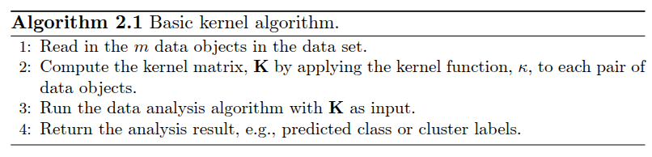

***mapping data into a higher dimensional data space can allow modeling of nonlinear relationships*** os algoritmos de kernel conseguem modelar relações não lineares, a partir de algoritmos lineares. geralmente isso é feito por meio de uma transformação que aumente a dimensão do espaço dos dados. 

***the kernel trick*** não aprofundei, precisa antes estudar o aumento de dimensão para então ler o trick do kernel.

### 2.4.8 *bregman divergence*

é uma familia de funções de proximidade, podendo serem utilizadas em algoritmos de agrupamento baseados nessa divergência. divergências de bregman são funções de perda ou distorção. um exemplo é o algoritmo *K-means* para clusterização.  

>**definição (*bregman divergence*)** dado uma funçaõ convexa estrita $\phi$, a divergência de Bregman (função de perda) D(x,y) gerado pela função é dado pela equação: $$D(x, y) = \phi(x) - \phi(y) - \langle \nabla \phi(y), (x - y) \rangle$$ onde $\nabla \phi(y)$ é o gradiente de $\phi$ calculado em y, e (x - y) é a diferença de vetor entre x e y, e $\langle \nabla \phi(y), (x - y) \rangle$ é o produto interno dos elementos. 

$D(x. y)$ pode ser escrita como $D(x, y) = \phi(x) - L(x)$, onde $L(x) = \phi(y) + \langle \nabla \phi(y), (x - y) \rangle$ e representa uma equação de um plano que é tangente da função $\phi$ em $y$. 

### 2.4.9 *issues in proximity calculation*

aqui será tratado alguns problemas comuns relacionados as medidas de proximidade.

***standardization and correlation for distance measures*** uma questão importante é lidar com atributos que não tem o mesmo intervalo de valores (diferente escalas). quando temos métricas diferentes, como renda e idade, utiliza-se da normalização para resolver. um outro problema relacionado é o cálculo de distância quando há correlação entre alguns atributos, então usa-se a *Mahalanobis distance*, que é uma generalização da distância euclidiana, que é útil também em dados com uma distribuição gaussiana (normal). variáveis correlacionadas tem um grande impacto em distâncias padrões, desde que uma mudança em qualquer variável correlacionado é refletida em uma mudança em todas as variáveis correlacionadas. a distância de Mahalanobis entre dois vetores x e y é definida como $$\text{Mahalanobis}(x, y) = \sqrt{(x - y)' \Sigma^{-1} (x - y)}$$, onde $\Sigma^{-1}$ é o inverso da covariância da matriz de dados. 

***combining similarities for heterogeneous attributes*** precisa-se de uma maneira de medir similaridade entre atributos de tipos diferentes. 

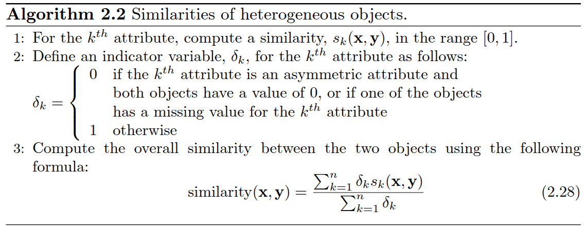

***using weights*** nos casos anteriores todos os atributos tinham a mesma importância, porém nem todos os problemas são assim. então para essas situações, as formulas para aproximação podem ser modificadas para ter um peso de contribuição para cada atributo, como exemplo $$\text{similarity}(x, y) = \frac{\sum_{k=1}^n w_k \delta_k s_k(x, y)}{\sum_{k=1}^n w_k \delta_k}$$, já a distancia de Minkowski vira $$d(x, y) = \left( \sum_{k=1}^n w_k \vert{}x_k - y_k\vert{}^r \right)^{1/r}$$

### 2.4.10 *selecting the right proximity measure*

o tipo da medida de proximidade deve se alinhar ao tipo do dado estudado. para vários tipos de dados densos e contínuos, métricas de distânciacomo a euclidiana são frequentemente utilizadas. proximidade entre atributos contínuos são mais expressadas em termos de diferença, e medidas de distância provêm isso.

para dados esparsos, normalmente utiliza-se medidas que ignoram matches 0-0. conceitualmente, um par de objetos complexos tem sua similaridade dependendo da quantidade de características que eles compartilham, enão as medidas de cosseno, Jaccard e extended Jaccard são apropriadadas.

para dados em vetores, o cosseno é mais adequado para documentos esparsos, já a correlação serve melhor para séries temporais. distâncias são mais usadas quando dois vetores de dados estão querendo ser comparados o mais próximo possível em relação a todos as features que possuem. 

